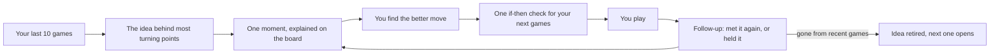

# Strategy: a coach for the mistake you keep making

Direction chosen 2026-10-10; launch decisions confirmed 2026-10-11. No active
users are using the current product, so this is a clean product cutover rather
than a migration. The website, user flow, UI, UX and pricing surface may be
replaced; preserve only code that serves the new loop. This document holds the
reasoning: problem evidence, audience, positioning, packaging, go-to-market,
metrics and the first phase. [Product](../apps/web/PRODUCT.md) states the
resulting intent. Everything below is a hypothesis until real players test it;
there is no first-party research yet.

## The decision

- **What Chessplain is:** a chess coach for the mistake you keep making. It
  finds the idea that keeps costing a player games, in their own games; gives
  them one concrete check for it; and watches their next games to show whether
  it is getting rarer.
- **What stays:** the analysis engine, its grounding rule, Chess.com game
  fetching, the board/replay primitives, authentication where useful, and a
  single-game explanation as evidence for the recurring idea. The current
  public UI and report flow are not protected.
- **What changes:** the product tracks a player's recurring idea, not one game;
  the website starts with the last-10-games scan; the report ends with a next
  step; the signed-in home opens on the idea; and the product is described as
  a coach, not a game review. Automatic follow-through is the proposed paid
  package; the owner has not approved that package yet.
- **First:** the owner recruits 5–10 players for a concierge test by hand. Then
  rebuild and ship phase 1 around the last-10-games scan. No background
  watching yet. The relaunch email waits until phase 1 ships.

## Why

**Situation.** Chessplain explains one game well: code-checked facts, about
20 s for a new game and about $0.0013 of model cost per report
([product review](PRODUCT_REVIEW.md)). It has not launched: 28 internal test
reports, no paying customers, and 320 legacy accounts that can receive one
relaunch email ([launch checklist](LAUNCH_CHECKLIST.md)).

**Complication.** The product is one-shot by construction:

1. Reviews don't connect. The model names each concept in free text, so "fork"
   and "double attack" never match across reports
   ([analysis roadmap](ANALYSIS_QUALITY_ROADMAP.md), output ownership table).
2. The product promises "one habit to check next game", and nothing checks the
   next game.
3. Nothing brings a player back: no game sync, no email, no scheduled job.
4. The report hands over the answer, so there is nothing to do.
5. Premium removes the weekly limit on something Chess.com gives away once a
   day: a game review.

Explaining a single game is also the most crowded part of the market:
Chess.com's Game Review and Coach, DecodeChess, Sensei, Ziuk and LearnChess all
do it in prose. Players are unimpressed ("That's an unfortunate error") and
describe a different problem: "the engine would tell me what I did wrong, but
never what I keep doing wrong."

**Resolution.** Follow one idea across a player's real games. Why now: the
relaunch email can only go out once, and the recurring-mistake space is starting
to fill (ChessLogix, Sensei, and an independent tool announced on the Chess.com
forum in August 2026).

## 1. Is the problem real?

Public forum talk from the last three years, mined on 2026-10-10. Forums
over-represent players who want to improve, the Reddit text came from an archive
snapshot, and one key quote comes from a post promoting a competing tool.

| Theme | Confidence | In their words |
|---|---|---|
| The same mistakes repeat, even when they know better | High (6+ threads) | "Hanging pieces I can clearly see… just completely forgetting basic principles I know I know." ([r/chessbeginners](https://www.reddit.com/r/chessbeginners/comments/1s93tts/how_do_you_train_when_your_brain_just_stops/)) |
| "Analyse your games" hasn't helped | High | "they all say the same things… 'Analyze your games'… but none of this has actually helped me." ([r/chess, 142 upvotes](https://www.reddit.com/r/chess/comments/1cvgz0g/why_cant_i_stop_blundering/)) |
| Tools say what went wrong, not what keeps going wrong | Medium (2 sources, one promotional) | "the engine would tell me what I did wrong, but never what I keep doing wrong." ([Chess.com forum](https://www.chess.com/forum/view/game-analysis/i-got-tired-of-reviewing-one-game-at-a-time-so-i-built-something-different)); a 2023 [Lichess thread](https://lichess.org/forum/game-analysis/tool-to-recognize-pattern--recurring-mistakes) asks for the same tool |
| They want the reason, short and concrete | High (5+) | "I wish there was somebody to explain why this is a mistake." and, in reply, "not concrete or memorable" ([r/chess, 230 upvotes](https://www.reddit.com/r/chess/comments/1e9af98/app_that_explains_stockfish_analysis_in_human/)) |
| Checklists and mistake logs don't stick | High (4+) | "I usually forget I have to do it after like 5 or 6 moves." ([r/chessbeginners](https://www.reddit.com/r/chessbeginners/comments/15tu7os/how_do_you_actually_build_a_habit_of_doing_the/)); "I got bored of it at the half." ([Chess.com forum](https://www.chess.com/forum/view/general/tips-for-building-your-own-blunder-database)) |
| Paying is contested | High that Game Review subscriptions are contested; Medium that a new tool gets paid | "I don't think diamond is worth it" ([Chess.com forum](https://www.chess.com/forum/view/community/is-it-worth-it-to-pay-for-chess-com)); "you could just… Play on Lichess?" ([r/chess](https://www.reddit.com/r/chess/comments/1krvvn0/ive_made_an_extension_that_helps_you_analyse_your/)) |

**Reading.** The problem is real and frequent for players who want to improve.
Two findings change the product, not just the copy:

- **Don't ask players to analyse or keep a log.** They say both failed. The
  product has to do the remembering.
- **Don't hand out generic checklists.** The sample report's habit ("Before
  every move, count what your opponent's pieces attack and what you defend") is
  the kind of advice players say they drop after five moves. A habit should be
  one if-then check tied to the player's own idea: "When their queen moves, look
  at everything it attacks."

Whether players will pay to fix the problem is unproven.

## 2. Who it is for

**Primary hypothesis:** adult online players, roughly 600–1800 on Chess.com, who
play most days, keep losing games the same way and want to stop, but won't keep
a log or run a checklist every move. They already open Game Review and find it
tells them what went wrong, not what keeps going wrong.

**Trigger moments:** a losing streak ("3, 4, 5 games in a row"), a rating
plateau, the same blunder twice in a week.

**Not for:**

- Players who play for fun and treat study as homework ("improvement
  treadmill"). There are many of them; they won't pay or come back for this.
- 2000+ players with coaches and engine workflows.
- Under-13s (terms).
- Bullet-only players: too much noise to track an idea honestly.

## 3. Form

The problem happens during games on Chess.com and Lichess; review happens
rarely. So the product does the remembering: it reads games from Chess.com's
public API (no login needed) and talks to the player on the web and, only when
there is something real, by email they opted into. Later candidates: a browser
extension that offers the review when a Chess.com game ends, and Lichess import
(when more than 20% of activated players come from Lichess, per the product
review). No native app for now.

## 4. Features

| Decision | Item | Why |
|---|---|---|
| Keep | Single-game review with no account | First value, and the evidence behind every claim about a player's pattern |
| Keep | Code-checked explanations on a board-first report | The trust advantage over vague coach text |
| Keep | Share links and image cards | Free acquisition |
| Change | Concepts: free text → a fixed list, code proposes and the model confirms | Nothing can be tracked across games without it (already on the analysis roadmap) |
| Change | Habit: generic checklist → one if-then check tied to the player's idea | Players say checklists are exhausting and forgotten |
| Change | End of a review: dead end → next moment, try it yourself, your next game | Today the only way forward is back |
| Change | Signed-in home: a list of reviews → the player's open idea | The product's state is the idea, not the archive |
| Propose, phase 2 | Premium: no weekly limit → automatic follow-through on the player's idea | Sells an ongoing service, not report volume; pending owner approval |
| Add, phase 1 | Scan of the last 10 games → the idea behind most turning points | Shows the core value in the first session |
| Add, phase 1 | Try the better move before the explanation | Active, and the move is already stored |
| Add, phase 1 | A one-tap check-in on the last habit when the next review opens | Connects reviews without claiming anything unverified |
| Add, phase 2 | Opt-in watching of new Chess.com games, follow-up lines, a note only when there is something real | The trigger, and honest proof that an idea is getting rarer |
| Defer, phase 3 | Past positions returning with fewer hints | Only if phases 1–2 show players return |
| Defer | Browser extension, Lichess import, coach or club features | Later channels |
| Cut | The "Keeps coming up" text list; abstract "how it works" cards on the homepage | Replaced by the open idea and a working demo |

## 5. Competition and positioning

**What players use instead:** Chess.com Game Review (one free a day), Lichess
analysis and "learn from your mistakes" (free), playing more, puzzles, YouTube, a
human coach, and AI coaches (Sensei, ChessLogix, Aimchess, LearnChess, Noctie).
Doing nothing is the biggest competitor.

**Where Chessplain wins:**

| What's different | Why it matters to the player |
|---|---|
| One idea at a time | Small enough to act on; they find full checklists "exhausting" |
| Explanations built on code-checked facts | Concrete reasons, not "an unfortunate error" |
| Follow-up in the games they actually play, told to them | The log they'd never keep, and proof they can trust |
| No account for the first scan or review | They see their own pattern before deciding anything |

**Where it doesn't compete:** engine depth (Lichess), courses (Chessable),
playing bots (Noctie), opening repertoires.

**Category:** chess coach, not game review. "Game review" frames Chessplain
against a free Chess.com feature; "chess coach" frames it against coaching,
where following up is the whole job. The site metadata already uses "AI chess
coach".

**Positioning statement:** For adult online players who keep losing games the
same way, Chessplain is a chess coach that finds the mistake you keep making in
your own games, gives you one concrete check for it, and watches your next games
to show whether it is getting rarer. Unlike Chess.com's Game Review, which grades
one game at a time, Chessplain follows the same idea across all your games and
only claims what the board shows.

**Messaging, phased so it is always true:**

- When the scan ships: "Find the mistake you keep making." Supporting line:
  "Chessplain reads your last 10 Chess.com games, names the idea behind most of
  your turning points, and shows you where it happened, on the board."
- When watching ships, add: "…and know when you've stopped."
- Use their words: "the same mistake", "keep making", "hanging pieces", "what I
  keep doing wrong", "blunder".
- Avoid: "analyse your games", "checklist", "accuracy", "insights",
  "AI-powered", and any promise of rating points.

## 6. The loop

- **First session, no account needed:** username → scan (about a minute,
  estimated; the Opera Game replay already covers the wait) → "Hanging pieces
  were the turning point in 3 of your last 10 games" → the clearest example as a
  full report → try it → the if-then check → sign in to keep tracking it.
  Sign-in is offered when it has a reason, not as a gate.
- **Returning:** the home screen opens on the open idea, its latest follow-up,
  the next games to review and one position to try.
- **Every screen has a next step.** None sends the player back to a blank form.
- **Retiring an idea** is the high point: say so plainly, offer an opt-in card to
  share it, and open the next idea.

## 7. Pricing and packaging

- **No migration constraint:** there are no active users to grandfather or
  protect from a packaging change. The old "unlimited game reviews" offer is
  not a product requirement.
- **Launch price hypothesis:** start with $9.99/month and $99.99/year, not
  because the old offer must survive, but because it is a simple prosumer price
  to test. Competitor prices and low model costs do not prove willingness to
  pay. Revisit after real purchase evidence rather than after internal debate.
- **Keep two tiers:** Free and Premium only. Do not add credits, multiple
  coaching levels or a team plan before the core loop has repeat use.
- **Free keeps:** the last-10-games scan, one open idea, the clearest example,
  practice on reviewed positions and the manual habit check-in. Keep the
  useful explanation and next step outside the paywall.
- **Premium would add once it exists:** automatic checks of new completed games
  for one connected Chess.com account (standard rapid, blitz and daily; no
  bullet), evidence-backed follow-ups on the open idea, optional email when
  something meaningful appears, and no weekly report quota for personal use.
  Email opt-in is separate from paying; follow-ups remain available on the
  site.
- **Promise:** follow-through, not a report or notification for every game.
  State the supported games and checking cadence. Do not promise real-time
  coaching, a rating gain, or that the player handled an idea merely because
  no mistake was found.
- **Clean-cutover rule:** rebuild the pricing page around the new loop. Do not
  carry "unlimited reviews" into the new positioning. If phase 1 ships before
  automatic watching, use an honest early-access/waitlist state rather than
  charging for a feature that does not exist.
- **Validate with the recruited players:** after the initial diagnosis,
  manually check later games and deliver a concrete follow-up. A paid manual
  continuation can test willingness, but label it as a pilot; it is not proof
  that automated watching has product-market fit.
- **Upgrade moment, once watching exists:** after a useful follow-up, offer to
  keep checking automatically. No countdowns or expiring discounts.
- **If players will not pay:** distinguish an unhelpful follow-up from a price
  objection before discounting. Credit packs are a fallback for occasional
  analysis, not the default model for ongoing follow-through.

## 8. Go-to-market

**Readiness.** Today's product is simple and complete, but by the owner's own
test it isn't lovable past one game. Phase 1 is the smallest version that is:
one idea (simple), about the player across games (lovable), and whole from
username to a check they carry into the next game (complete).

**Sequence:**

1. **Concierge test, before building anything:** the owner has committed to
   recruiting 5–10 real players. Review their last 10 games with today's
   product, group the moments by hand and ask "is this you?" This tests H1 and
   H2 without code. Recruitment is agreed; sessions have not happened yet.
2. **Relaunch email:** held until phase 1 ships (owner decision, 2026-10-11).
   Refresh the draft for what actually shipped and recheck the subscribed
   segment before sending. No send date has been agreed.
3. **Reddit, value first:** answer "why can't I stop blundering" threads with a
   free scan, within each community's rules.
4. **Small creators** (1k–50k followers): "what my last 10 games say about me" is
   a natural video.
5. **SEO:** one guide per concept in the fixed list ("How to stop hanging
   pieces"). The concept list doubles as the content plan.
6. **Owned channel:** grow the email list through sign-in, with an explicit
   opt-in for follow-up notes.

## 9. How we'll know

| Goal | Signal | Metric and starting threshold |
|---|---|---|
| Players see the value in session one | They reach their idea and try the position | Share of username submissions that reach "your idea" and make one try; target 40% (a guess to recalibrate) |
| They come back on their own | Return within a week | D7 return of activated players ≥ 25% (the product review's gate) |
| It helps | The idea gets rarer | Share of open ideas retired within 30 days; focus-idea turning points per 10 games, shown only after 10 games |
| They pay for the loop | Upgrades after a follow-up | First 3 payers within a month of phase 2; none after 200 activated players → revisit packaging |
| Trust holds | Concept tags are right | ≥ 90% correct on a labelled set before follow-ups ship; "this is wrong" on < 5% of follow-ups |

**Counter-metrics:** email unsubscribes (< 0.5%), "this is wrong" reports,
screens that end without a next step (should be none), and time per visit (not a
goal; spikes mean confusion).

Traffic is too small for A/B tests at first. Pair the numbers with the concierge
sessions and every reply to the relaunch email.

## 10. Hypotheses

| # | We believe | Test | Pass | If it fails |
|---|---|---|---|---|
| H1 | For most players, 1–3 ideas account for most turning points | Concierge test, then scan the last 20 rapid and blitz games of 10 players with the new concept list | The top idea covers ≥ 30% of turning points for 7 of 10 | Lead with practice on your own positions instead of "your mistake" |
| H2 | Players recognise their top idea as true and worth fixing | 5–10 concierge sessions | 7 of 10 agree without prompting | Rework the concept list or how ideas are worded |
| H3 | A check-in on the last habit brings players back more than a plain report | D7 return before and after phase 1 (directional; small numbers) | ≥ 25% | Bring watching and the follow-up note forward |
| H4 | Players pay for follow-up more readily than for unlimited reviews | Upgrades after phase 2, plus interview questions | 3 payers in the first month | Test credit packs |
| H5 | Code-proposed concepts are accurate | 50–100 labelled moments | ≥ 90% correct | Track fewer concepts; leave the rest model-named and untracked |

## 11. Phase 1

**Outcome:** a player goes from their Chess.com username to their recurring
idea, one explained moment, a try, and a check for their next game, with no dead
end.

**Builds:**

1. **Fixed concept list, code first.** Start with what `chess-facts.ts` can
   support: a hanging piece, a double attack, a missed mate threat, a weak back
   rank and a losing exchange (attackers against defenders). Everything else
   stays model-named and untracked. Store a `concept_id` on each moment. Prompt
   changes bump `PROMPT_VERSION`, are mirrored in
   [the moment prompt doc](MOMENT_PROMPT.md), and rerun the benchmark.
2. **The scan.** The last 10 Chess.com games (rapid, blitz and daily; no
   bullet): fast sweep, depth-20 verify, concept tag, and the model only for the
   one example report. "Nothing decisive" must be a real result, so the
   quiet-drift fallback in `select.ts` is off for scans.
3. **The forward flow.** Next moment; try it yourself, with three honest
   outcomes (the checked move, your original move with its refutation, or
   "different from the line we checked"); the habit as an if-then check; your
   next games on the same page; and the check-in when the next review opens.
4. **Signed-in home** opens on the open idea.

**Not in this cut:** automatic watching, email, spaced practice, Lichess,
price changes to unvalidated amounts, and any feature that needs historical
pattern claims before concept IDs work. The public website, homepage,
navigation, pricing surface and report flow may be rebuilt or replaced; old UI
compatibility is not a goal.

**Stop when:** the path works end to end for real usernames, concept tags reach
90% on the labelled set, and every screen has a next step.

**Phase 2:** watching, follow-ups, the opt-in note, premium repositioned, and a
record of positions where an idea came up and the player handled it, so "held
it" rests on evidence. **Phase 3:** past positions returning with fewer hints.

### Clean cutover boundary

- **Reusable:** `runAnalysisPipeline`, the verified board moments, the
  `ChessboardView`/report interaction primitives, Chess.com fetching, auth and
  share links where they still fit.
- **Replace:** the homepage promise and entry form, the username-to-game
  selection flow, the report completion state, signed-in home, navigation,
  pricing copy and every dead-end CTA.
- **Backend prerequisite:** the current API stores free-text `concept_name`
  values and `/api/me` only groups them case-insensitively. The scan needs a
  code-derived `concept_id`, a batch/scan endpoint that can process the ten
  games without creating ten full paid reports, and persisted scan results.
  Do not fake this with client-side sample data.
- **Stop condition:** a real username reaches a real recurring idea, one
  evidence-backed example, a try-it interaction and a saved next-game check;
  no screen ends at the old blank review form.

## 12. Risks

- **A wrong "you did it again" breaks trust** faster than no follow-up.
  Mitigation: code-first concepts and the 90% gate.
- **Mistakes may not cluster (H1).** Then lead with practice instead.
- **Players may not pay**; the evidence on paying is contested. Keep the free
  tier useful, sell watching, and keep credit packs as the fallback.
- **Chess.com could follow up too.** Insights already compares motif rates
  between periods (top tier only). The answer is speed, one idea at a time,
  concreteness, and Lichess later.
- **Others are building in this space** (ChessLogix, Sensei, independent tools).
  The answer: the follow-up is told to the player, and every claim can be
  checked on the board.
- **Engine time.** A scan costs about a minute of engine time. That is fine at
  today's scale, but there is no alert on queue age yet.
- **Homework fatigue.** One idea and one check; never ask players to log
  anything.

## 13. Owner decisions

Confirmed 2026-10-11:

1. **Front door:** Chess.com usernames start with the last-10-games scan, not
   "pick a game". Single-game review remains available.
2. **Relaunch email:** wait until phase 1 ships. No send date set.
3. **Premium in phase 2 — still open:** the owner asked for a recommendation,
   not a price or package change. Section 7 proposes automatic follow-through
   at the current prices; the live offer is unchanged.
4. **Concierge test:** the owner will recruit 5–10 players for the hand test.
   This is a recruitment commitment, not completed research.
